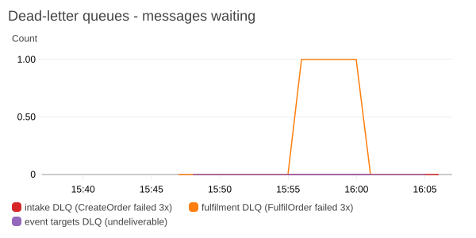
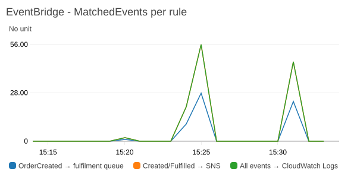
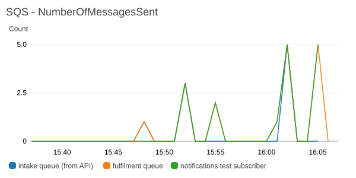
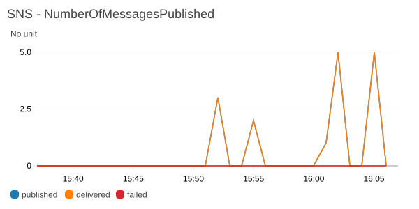

# Event-Driven Orders Application (AWS SAM)

An orders backend that grows, exercise by exercise, from a synchronous REST API into an
event-driven system: Amazon EventBridge, SQS, SNS, CloudWatch, an asynchronous API, dead-letter
queues, idempotent processing and multi-region disaster recovery with EventBridge Global
Endpoints. Everything is defined in a single [AWS SAM](https://docs.aws.amazon.com/serverless-application-model/)
template and deployed as updates to one CloudFormation stack (`orders-event-driven-app`).

| | |
|---|---|
| **IaC** | AWS SAM (CloudFormation transform) — one template, one stack per region |
| **Runtime** | Python 3.12 on arm64 (Graviton) |
| **Regions** | us-east-1 (primary) + us-west-2 (secondary) — the full stack runs in both (exercise 9) |

## Progress

| # | Exercise | Services | Status |
|---|---|---|---|
| 0 | Baseline orders API | API Gateway, Lambda, DynamoDB, Cognito | ✅ Done |
| 1 | Publish events | EventBridge | ✅ Done |
| 2 | Process messages | SQS, Lambda, DynamoDB | ✅ Done |
| 3 | Send notifications | SNS | ✅ Done |
| 4 | Monitoring | CloudWatch dashboard | ✅ Done |
| 5 | CI/CD | GitHub Actions (OIDC) | ✅ Done |
| 6 | Asynchronous API | API Gateway → SQS | ✅ Done |
| 7 | Dead-letter queues | SQS | ✅ Done |
| 8 | Idempotency | Lambda, DynamoDB conditional writes | ✅ Done |
| 9 | Disaster recovery | EventBridge Global Endpoints, DynamoDB global tables, Cognito multi-Region replication | ✅ Done |
| 10 | Cost estimate | AWS Pricing Calculator | ✅ Done — [docs/cost-estimate.md](docs/cost-estimate.md) |

## Architecture (current)

```
                 ┌──────────────────────┐
                 │ Cognito User Pool    │ 1. sign in → ID token (JWT)
        ┌───────►│ admin-created users  │
        │        └──────────┬───────────┘
        │                   │ validates JWT
 client ┴──► ┌──────────────▼───────────┐ SendMessage ┌──────────────────────────┐
 HTTPS       │ API Gateway (REST)       │────────────►│ SQS: <stack>-order-intake│  202 returned as soon as
 Authorization│ stage prod · REGIONAL   │ direct AWS  │ body = items, attributes │  the message is queued
 : <IdToken> │ PUT /orders/{orderId}    │ integration │ orderId, customerId,     │
             │  JSON-schema validation  │ (VTL, role) │ acceptedAt, requestId    │
             │ GET /orders/{orderId}    │             └────────────┬─────────────┘
             │  BatchGetItem (no Lambda)│                          │ event source mapping, batch 10
             │ Cognito authorizer       │             ┌────────────▼───────────────┐      ┌───────────────────────────┐
             │ throttle 100 rps/50 burst│             │ Lambda: CreateOrder        │─────►│ DynamoDB: Orders          │
             └────────────┬─────────────┘             │ python3.12 / arm64 / 256MB │trans-│ PK orderId · SK sk        │
                          │ GET reads Orders header   │ BatchProcessor, REJECTED   │action│ ORDER header + ITEM# lines│
                          │ + Fulfilments directly    │ for invalid orders         │      │ on-demand · SSE · PITR    │
                          └ ─ ─ ─ ─ ─ ─ ─ ─ ─ ─ ─ ─ ─ ┴─────────────┬──────────────┴ ─ ─ ►└───────────────────────────┘
                                                                    │ PutEvents (after the write succeeds)
                                              ┌─────────────────────▼──────┐      ┌───────────────────────────┐
                                              │ EventBridge custom bus     │rule  │ CloudWatch Logs           │
                                     ┌───────►│ orders-event-driven-app-bus│─────►│ /aws/events/<stack>       │
                                     │        │ source orders.service      │all   │ copy of every order event │
                                     │        │ OrderCreated/OrderFulfilled│events│ (14-day retention)        │
                                     │        └──────┬──────┬──────────────┘      └───────────────────────────┘
                                     │               │      │ rule: detail-type = OrderCreated
                                     │               │      │
                                     │   rule: OrderCreated + OrderFulfilled, InputTransformer
                                     │               │      │      ┌────────────────────────┐  raw   ┌─────────────────────┐
                                     │               └──────┼─────►│ SNS: order-            │───────►│ SQS test subscriber │
                                     │                      │      │ notifications          │delivery│ <stack>-            │
                                     │                      │      │ policy: only the rule  │        │ notifications-test  │
                                     │                      │      └────────────────────────┘        └─────────────────────┘
                                     │        ┌─────────────▼──────────────┐
                                     │        │ SQS: <stack>-fulfilment    │ SSE-SQS · visibility 60 s
                                     │        │ queue policy: only the rule│ (6× function timeout)
                                     │        └─────────────┬──────────────┘
                                     │                      │ event source mapping: batch 10,
                                     │                      │ ReportBatchItemFailures
                                     │        ┌─────────────▼──────────────┐      ┌───────────────────────────┐
                                     │        │ Lambda: FulfilOrder        │─────►│ DynamoDB: Fulfilments     │
                                     └────────│ Powertools BatchProcessor  │ Put  │ PK orderId · warehouse,   │
                              PutEvents       │ python3.12 / arm64 / 256MB │      │ status, fulfilledAt       │
                              OrderFulfilled  └────────────────────────────┘      └───────────────────────────┘
```

**Request path (asynchronous, exercise 6):** `PUT /orders/{orderId}` with a client-generated UUID.
API Gateway checks the JWT (Cognito authorizer), validates the body against a JSON-schema model,
checks the `orderId` format in the mapping template, and sends the body straight to the SQS
**intake queue** — `orderId`, `customerId` (the token's `sub` claim, never the body), the request
time and request id travel as message attributes — then returns **202 Accepted** without waiting
for any Lambda. CreateOrder consumes the queue in batches: re-checks the payload (rules a schema
can't express, e.g. duplicate `itemId`s → stored as `REJECTED`), writes the header and every line
in one `TransactWriteItems` (or nothing), then publishes `OrderCreated` to the custom bus. A rule
copies every `orders.service` event to CloudWatch Logs for inspection.

**Status path:** `GET /orders/{orderId}` is a second direct integration: one DynamoDB
`BatchGetItem` reads the Orders header and the Fulfilments item, and a response template returns
`CREATED` / `FULFILLED` / `REJECTED` — or 404 if the order isn't the caller's or isn't processed
yet. Since exercise 9 it also returns `createdIn` / `fulfilledIn` (the regions that did the work)
and `servedBy` (the API's domain).

**Fulfilment path (asynchronous):** a second rule routes `OrderCreated` to the SQS fulfilment
queue → FulfilOrder (event source mapping) records the fulfilment (simulated warehouse, chosen by
a hash of `orderId`) in the Fulfilments table → publishes `OrderFulfilled` back to the bus.
The API response doesn't wait for any of this.

**Notification path:** a third rule matches `OrderCreated` and `OrderFulfilled` and publishes a
short notification (built by an EventBridge **input transformer**) to the SNS topic. An SQS
queue subscribed with raw message delivery stands in for real subscribers (email, SMS,
webhooks, other services) so delivery can be checked from the CLI.

### Multi-region, active-active (exercise 9)

```
                       ┌──────────── Cognito user pool us-east-1_bx86ahbOz ────────────┐
                       │  primary (us-east-1)  ══ multi-Region replication ══►  replica (us-west-2)
                       │  one directory: same users, same `sub`, same app client id, multi-Region KMS key
                       └───────────────────────────────────────────────────────────────┘
   client ──► API us-east-1 (PUT/GET)                     client ──► API us-west-2 (PUT/GET)
                │ SQS → CreateOrder                                    │ SQS → CreateOrder
                ▼                                                      ▼
        ┌──────────────────────── DynamoDB global tables (Orders, Fulfilments) ───────────────────┐
        └─────────────────────────────── replicated both ways ────────────────────────────────────┘
                │ PutEvents(EndpointId) - SigV4a (awscrt layer)        │
                └──────────────────────────┬───────────────────────────┘
                                           ▼
                    EventBridge global endpoint  bfuowrpror.veo
                    healthy ─► bus us-east-1      Route 53 health check ◄── alarm: IngestionToInvocation-
                    unhealthy ─► bus us-west-2                              StartLatency > 30 s for 5 min
                    + replication: every event also copied to the other region's bus
                                           │
        bus us-east-1 ◄──── managed replication rules ────► bus us-west-2
        rules: region = us-east-1                           rules: region = us-west-2
        → fulfilment queue, SNS                             → fulfilment queue, SNS
        (copies ingested in us-west-2 are ignored)          (copies ingested in us-east-1 are ignored)
```

- **Both regions serve the API** (each has its own API Gateway, queues, Lambdas, bus, SNS topic,
  dashboard and DLQs) and read/write the same **DynamoDB global tables**, so an order placed in
  one region can be read — and shows its fulfilment — in the other.
- **Events go through the global endpoint.** While the primary is healthy every event is
  ingested by the us-east-1 bus, whichever region published it; on failover the endpoint routes
  to us-west-2. Replication is on (AWS recommends it; it's also what makes failback automatic),
  so every event also lands on the other bus.
- **Process where ingested.** The fulfilment and notification rules match only events whose
  `region` (the ingesting region, kept on replicated copies) is their own region, so each event
  is processed exactly once; the copies are kept only for audit (the log-group rule records
  everything) and failback.
- **One user directory.** Cognito multi-Region replication keeps a replica of the primary user
  pool in us-west-2 (same pool id, users, `sub` and app client id), so a user signs in in either
  region and owns the same orders in both. Users are created in the primary only.

**Idempotency (exercise 8):** the client-generated `orderId` is the idempotency key, and the
order header doubles as the idempotency record. CreateOrder processes a message like this:

```
claim: TransactWriteItems(header IN_PROGRESS + payloadHash + claimedBy=<messageId> + lock 30 s,
                          all lines)  IF attribute_not_exists(orderId)
 ├─ won ──────────────────────────────► PutEvents(OrderCreated) ─► header COMPLETED (+ eventId)
 └─ lost (orderId exists) ─► read header (consistent)
      ├─ different payloadHash (other items / other customer) ─► ORDER_ID_CONFLICT, drop, no change
      ├─ COMPLETED ─────────────────────► return the stored result, no side effects
      └─ IN_PROGRESS
           ├─ claimed by this message, or lock expired ─► take over (conditional) ─► publish ─► COMPLETED
           └─ live claim of another message ───────────► drop (that message finishes, or its retry does)
```

A publish failure now **fails the record**: SQS retries it after the visibility timeout, the
retry finds its own unfinished claim and resumes — the event is published exactly when the order
exists, closing the dual-write gap of exercise 1. FulfilOrder uses the same claim → publish →
complete pattern on its Fulfilments item, so a duplicated `OrderCreated` is fulfilled once.

**Failure handling (exercise 7):**

```
 order-intake ──(3 failed receives)──► order-intake-dlq ─┐
 fulfilment   ──(3 failed receives)──► fulfilment-dlq   ─┼─► CloudWatch alarm "<dlq>-not-empty" ──► SNS ops-alerts
 rule targets ──(185 retries / 24 h)─► event-targets-dlq ┘
        ▲                                     │
        └──── redrive (SQS StartMessageMoveTask, back to the original queue) ◄──┘
```

- **Consumer DLQs** — both source queues have `RedrivePolicy {maxReceiveCount: 3}`: a message
  CreateOrder/FulfilOrder fails to process three times (exception → batch item failure → visible
  again after the 60 s visibility timeout) is moved to its DLQ instead of being retried until the
  4-day retention expires. DLQs keep messages 14 days; `RedriveAllowPolicy` lets only the
  matching source queue use each DLQ.
- **Event-target DLQ** — each EventBridge rule target has a `DeadLetterConfig` and an explicit
  retry policy: events EventBridge can't *deliver* (missing permission, deleted target, …) land
  there instead of being dropped.
- **Alarms** — one per DLQ (`ApproximateNumberOfMessagesVisible > 0`), sending to the
  `ops-alerts` SNS topic (no subscriber by default; subscribe an email to be paged).

**Observability:** X-Ray active tracing on the API stage and the Lambdas; structured JSON logs
(Powertools `Logger`, correlation id = API Gateway request id, `app_version` key); a copy of
every event in `/aws/events/<stack>`; and the CloudWatch dashboard
`orders-event-driven-app-dashboard` (stack output `DashboardUrl`):

| Widget | Metrics |
|---|---|
| EventBridge — MatchedEvents per rule | `AWS/Events MatchedEvents` (dims `EventBusName` + `RuleName`) for the 3 rules |
| SQS — NumberOfMessagesSent | `AWS/SQS NumberOfMessagesSent` for the intake queue, the fulfilment queue and the test subscriber |
| SNS — NumberOfMessagesPublished | `AWS/SNS NumberOfMessagesPublished`, `NumberOfNotificationsDelivered`, `NumberOfNotificationsFailed` |
| EventBridge — FailedInvocations per rule | Target delivery failures (permissions, throttling) |
| SQS — backlog | `ApproximateNumberOfMessagesVisible`, `ApproximateAgeOfOldestMessage` (intake + fulfilment queues) |
| Lambda — Invocations & Errors | CreateOrder and FulfilOrder |
| API Gateway — requests & errors | `Count`, `4XXError`, `5XXError` (stage `prod`) |
| Duration p90 | API Gateway `Latency`, Lambda `Duration` for both functions |
| Dead-letter queues | Messages waiting in the 3 DLQs + the 3 DLQ alarms |



| EventBridge `MatchedEvents` | SQS `NumberOfMessagesSent` | SNS `NumberOfMessagesPublished` |
|---|---|---|
|  |  |  |

Images rendered from the deployed dashboard with `scripts/check_dashboard.py --images`
(CloudWatch `GetMetricWidgetImage`). Window: exercise 6 tests (15:20) and two 20-order bursts; over those
20 minutes 64 orders reached the intake queue and 62 the fulfilment queue — the other two were
the rejected order (duplicate `itemId`) and a duplicate `orderId` CreateOrder skipped.

## Data model

`orders-event-driven-app-orders-global` — a DynamoDB **global table** (us-east-1 + us-west-2,
exercise 9; it replaced `orders-event-driven-app-Orders`), one partition per order:

| Item | `orderId` (PK) | `sk` (SK) | Attributes |
|---|---|---|---|
| Header | UUID v4 (client-generated since exercise 6) | `ORDER` | `customerId` (Cognito `sub`), `status` (`CREATED` / `REJECTED`), `total` (N), `itemCount`, `acceptedAt` (API request time), `createdAt` (saved by CreateOrder), `createdIn` (region, exercise 9), `reason` (only when `REJECTED`); idempotency (exercise 8): `payloadHash` (SHA-256 of customer + sorted, normalised items), `processingState` (`IN_PROGRESS` → `COMPLETED`), `claimedBy` + `lockExpiresAt` (only while in progress), `eventId`, `completedAt` |
| Line | same | `ITEM#<itemId>` | `itemId`, `productName`, `quantity` (N), `unitPrice` (N) |

### Event: `OrderCreated`

`source: orders.service`, `detail-type: OrderCreated`, bus `orders-event-driven-app-bus`.
Money values are strings so consumers never lose precision to floats.

```json
{
  "orderId": "adf157f7-011f-416e-974b-9c900f9d5299",
  "customerId": "843874a8-4081-70c7-f151-d3c8ab4c97c2",
  "items": [{"itemId": "SKU-1001", "productName": "Wireless Mouse", "quantity": 2, "unitPrice": "24.99"}],
  "itemCount": 1,
  "total": "49.98",
  "createdAt": "2026-10-18T14:08:48.471944+00:00"
}
```

### Event: `OrderFulfilled`

```json
{"orderId": "…", "customerId": "…", "warehouse": "PDX-1", "itemCount": 2, "total": "99.48",
 "orderCreatedAt": "2026-10-18T14:20:19.072+00:00", "fulfilledAt": "2026-10-18T14:20:20.419+00:00"}
```

### Notification (SNS message)

Built by the input transformer — subscribers get a small, stable message instead of the full
order with items and prices:

```json
{
  "type": "OrderFulfilled",
  "orderId": "e910267c-7708-4ce0-b3f9-5ea341d559b8",
  "customerId": "843874a8-4081-70c7-f151-d3c8ab4c97c2",
  "total": "1",
  "warehouse": "CMH-1",
  "time": "2026-10-18T14:30:57Z",
  "message": "OrderFulfilled: order e910267c-7708-4ce0-b3f9-5ea341d559b8 (total 1)"
}
```

`warehouse` is `""` for `OrderCreated` (the path doesn't exist in that event).

### Table: `orders-event-driven-app-fulfilments-global` (global table since exercise 9)

| Attribute | Notes |
|---|---|
| `orderId` (PK) | Same id as the order |
| `status` | `FULFILLED` |
| `warehouse` | `IAD-1` / `CMH-1` / `PDX-1` (simulated; stable per order) |
| `customerId`, `itemCount`, `total` | Copied from the event (`total` kept as a string) |
| `orderCreatedAt`, `fulfilledAt` | ISO-8601 UTC — the difference is the end-to-end async latency |
| `sourceEventId` | EventBridge event id that produced the fulfilment (traceability) |
| `processingState`, `claimedBy`, `lockExpiresAt` | Idempotency claim (exercise 8): `IN_PROGRESS` until `OrderFulfilled` is published, then `COMPLETED` |
| `fulfilledIn` | Region whose FulfilOrder processed it (exercise 9) |

A `Query` on `orderId` returns the whole order. The header item gives later exercises one place
for order-level state (status, idempotency/processing state) without changing the table schema.

## Repository layout

```
template.yaml                 SAM template (all application infrastructure)
samconfig.toml                Deploy config: "default" env (local, pinned profile) and "ci" env
src/create_order/app.py       CreateOrder Lambda handler (API → DynamoDB → EventBridge)
src/fulfil_order/app.py       FulfilOrder Lambda handler (SQS → DynamoDB → EventBridge)
scripts/measure_fulfilment.py Sends N orders and breaks down the async fulfilment latency
scripts/check_notifications.py Sends N orders and reads the SNS notifications from the test queue
scripts/check_dashboard.py    Checks every dashboard metric has data; renders widgets to docs/images/
scripts/dlq_demo.py           DLQ demos: poison messages, and a consumer outage + redrive
scripts/idempotency_test.py   Duplicate/concurrent/conflicting requests and a publish failure, counted end to end
scripts/dr_test.py            Multi-region checks: normal routing, failover and failback timing
scripts/build_crt_layer.sh    Builds the awscrt (SigV4a) layer for Linux arm64
scripts/copy_tables.py        Exports/imports DynamoDB items (used to migrate to global tables)
scripts/activate_user_pool_replica.py  Activates the Cognito user pool replica in us-west-2
scripts/smoke_test.sh         Post-deploy smoke test for one region (used by CI)
events/create_order.json      Sample API Gateway-style event
tests/unit/                   pytest + moto unit tests
requirements-dev.txt          Test dependencies
infra/github-oidc.yaml        One-time CI/CD bootstrap (GitHub deploy role + CloudFormation execution role)
infra/global-endpoint.yaml    EventBridge global endpoint, Route 53 health check, alarm, replication role
layers/crt/                   awscrt layer (built by scripts/build_crt_layer.sh, not committed)
.github/workflows/deploy.yml  GitHub Actions: test → deploy → smoke tests
```

## Getting started

**Prerequisites:** AWS CLI v2 (configured profile), AWS SAM CLI, Python 3.12.

```bash
# Unit tests
python -m venv .venv
.venv/Scripts/python -m pip install -r requirements-dev.txt   # Windows (.venv/bin on macOS/Linux)
.venv/Scripts/python -m pytest -q

# Build and deploy (settings come from samconfig.toml)
bash scripts/build_crt_layer.sh       # awscrt layer for SigV4a (exercise 9)
sam validate --lint
sam build && sam deploy                                   # us-east-1 (primary) - first
sam build --config-env dr && sam deploy --config-env dr   # us-west-2 (secondary)
```

First-time setup of the second region, in order (each step depends on the previous one):
1. Deploy the primary stack — it creates the global tables (with the us-west-2 replicas), the user
   pool, its multi-Region KMS key and the user pool replica.
2. `python scripts/activate_user_pool_replica.py ACTIVE` (the replica is created `INACTIVE`).
3. Deploy the secondary stack with `PrimaryUserPoolKeyArn`, `PrimaryUserPoolId`,
   `PrimaryUserPoolClientId` (primary stack outputs; `samconfig.toml` `dr` env).
4. Deploy `infra/global-endpoint.yaml` in us-east-1, then redeploy both app stacks with
   `GlobalEndpointId` = its `EndpointId` output.

### Calling the API

Self sign-up is disabled, so create a user as an admin first (IDs from the stack outputs
`UserPoolId` and `UserPoolClientId`):

```bash
aws cognito-idp admin-create-user --user-pool-id $USER_POOL_ID --username you@example.com \
  --user-attributes Name=email,Value=you@example.com Name=email_verified,Value=true \
  --message-action SUPPRESS
aws cognito-idp admin-set-user-password --user-pool-id $USER_POOL_ID --username you@example.com \
  --password '<strong-password>' --permanent

TOKEN=$(aws cognito-idp initiate-auth --auth-flow USER_PASSWORD_AUTH --client-id $CLIENT_ID \
  --auth-parameters USERNAME=you@example.com,PASSWORD='<strong-password>' \
  --query AuthenticationResult.IdToken --output text)

# Place an order: the client generates the orderId (the idempotency key)
ORDER_ID=$(python -c "import uuid; print(uuid.uuid4())")
curl -X PUT "$API_URL/orders/$ORDER_ID" -H "Authorization: $TOKEN" -H 'Content-Type: application/json' \
  -d '{"items":[{"itemId":"SKU-1001","productName":"Wireless Mouse","quantity":2,"unitPrice":24.99}]}'
# 202 {"orderId": "...", "status": "ACCEPTED", "statusUrl": "/orders/...", "messageId": "..."}

# Check its status (a few hundred ms later)
curl "$API_URL/orders/$ORDER_ID" -H "Authorization: $TOKEN"
# 200 {"orderId": "...", "status": "FULFILLED", "total": "49.98", "warehouse": "IAD-1", ...}
```

| Request | Response | When |
|---|---|---|
| `PUT /orders/{orderId}` | `202 {"orderId", "status": "ACCEPTED", "statusUrl", "messageId"}` | Order queued (processing happens afterwards) |
| | `400 {"message": "<schema violation>"}` | Body fails the JSON schema: empty/>25 items, missing field, `quantity` < 1, `unitPrice` < 0, unknown property, … |
| | `400 {"message": "orderId must be a lowercase UUID…"}` | Path isn't a lowercase UUID |
| | `415` | `Content-Type` other than `application/json` |
| `GET /orders/{orderId}` | `200 {"orderId", "status", "acceptedAt", "createdAt", "total", "itemCount", ["warehouse", "fulfilledAt"] / ["reason"]}` | `status`: `CREATED`, `FULFILLED`, or `REJECTED` (with `reason`, e.g. duplicate `itemId`) |
| | `404` | Unknown id, not processed yet, or another customer's order |
| both | `401` | Missing or invalid ID token |
| both | `429` | API Gateway throttling (100 rps, burst 50) |

## CI/CD

Every push to `main` runs [`.github/workflows/deploy.yml`](.github/workflows/deploy.yml):

```
push to main ──► test job ──────────────► deploy job ───────────────────────────────────────────►
                 pytest (moto, no AWS)    OIDC → assume deploy role (no stored access keys)
                                          sam validate --lint → sam build →
                                          sam deploy --config-env ci --role-arn <cfn-execution>
                                                     --parameter-overrides AppVersion=<commit SHA>
                                          smoke tests: POST /orders without token → 401;
                                          event bus / queue / topic / dashboard outputs present
```

Pull requests run the tests only; `concurrency` prevents two deployments running at once.
Since exercise 9 the deploy job builds once and deploys **both regions** in order — us-east-1
(owns the global tables and the user pool) then us-west-2 — looking up the global endpoint id and
the primary's user pool/KMS outputs instead of hard-coding them, and smoke-tests each region with
`scripts/smoke_test.sh`.

**AWS access without stored credentials.** The exercise asks for "AWS credentials stored as GitHub
repository secrets"; instead of access keys, the secrets hold only two **role ARNs**, and GitHub's
OIDC token is exchanged for short-lived credentials (1 h max):

| Secret | Role | Can do |
|---|---|---|
| `AWS_DEPLOY_ROLE_ARN` | `aws-event-driven-application-github-deploy` | Assumable **only** by workflows on `main` of this repo (trust on the immutable-ID subject `repo:sriram-um@93265789/aws-event-driven-application@1424480922:ref:refs/heads/main`). Change sets on `orders-event-driven-app` only, SAM artifact bucket, `iam:PassRole` of the execution role. |
| `AWS_CFN_EXECUTION_ROLE_ARN` | `aws-event-driven-application-cfn-execution` | AdministratorAccess, but assumable only by `cloudformation.amazonaws.com` — CloudFormation makes the resource changes, GitHub never holds admin credentials. |

Both roles come from the bootstrap stack `aws-event-driven-application-github-oidc`
([`infra/github-oidc.yaml`](infra/github-oidc.yaml)), deployed once by hand:

```bash
aws cloudformation deploy --template-file infra/github-oidc.yaml \
  --stack-name aws-event-driven-application-github-oidc --capabilities CAPABILITY_NAMED_IAM
```

The account's GitHub OIDC provider already existed (created by Project 3) and there can only be
one per account, so the template references its ARN instead of creating it.
`samconfig.toml` has a `ci` config env without a `profile` (credentials come from the OIDC step).

## Cost

Details in [docs/cost-estimate.md](docs/cost-estimate.md) (list prices from the AWS Price List API).

| | 100 k orders, 5 k MAU | 1 M orders, 50 k MAU | Idle |
|---|---|---|---|
| Event pipeline + API + data (both regions) | ≈ $4.70 | ≈ $37 | ≈ $1 (SQS polling) |
| Fixed (dashboards, detailed metrics, alarms, KMS, health check) | ≈ $17.60 | ≈ $17.60 | ≈ $3 |
| Cognito (Essentials + multi-Region replication) | $22.50 | ≈ $825 | < $0.01 |
| **Total / month** | **≈ $47** | **≈ $895** | **≈ $4** |

The event-driven core (EventBridge, SQS, SNS and both Lambdas) costs under $2 per 100,000
orders, including cross-region replication. Identity DR (Cognito multi-Region replication) and
per-method API metrics dominate.

## Teardown

Delete in this order — each step depends on the previous one:

```bash
export AWS_PROFILE=default
# 1. Global endpoint first: its managed replication rules sit on both buses, and a bus with
#    rules can't be deleted
aws cloudformation delete-stack --region us-east-1 --stack-name orders-event-driven-app-global-endpoint
aws cloudformation wait stack-delete-complete --region us-east-1 --stack-name orders-event-driven-app-global-endpoint

# 2. Cognito replica must be INACTIVE before it can be deleted
python scripts/activate_user_pool_replica.py INACTIVE

# 3. Secondary region (it only references the replicas; deletes its KMS replica key - 7-day wait)
sam delete --config-env dr --no-prompts

# 4. Primary region: global tables and their replicas, user pool + replica, KMS key
#    (scheduled for deletion after 7 days, once its replica is gone)
sam delete --no-prompts

# 5. CI/CD bootstrap roles
aws cloudformation delete-stack --region us-east-1 --stack-name aws-event-driven-application-github-oidc
```

Then check:
- `aws kms list-keys` / the KMS console: both keys show `PendingDeletion` (or
  `PendingReplicaDeletion`) — they stop billing once deleted.
- DynamoDB in both regions: no `orders-event-driven-app-*` tables.
- The SAM artifact buckets `aws-sam-cli-managed-default-*` in both regions are shared with other
  projects (us-east-1 with Project 3) — empty the `orders-event-driven-app/` prefix only.
- GitHub: remove the repository secrets `AWS_DEPLOY_ROLE_ARN` / `AWS_CFN_EXECUTION_ROLE_ARN`.
- Billing → Bills the next day: no remaining `us-west-2` / Route 53 / KMS charges for the project.

## Design decisions

- **New, slim stack instead of extending Project 3** — the event-driven exercises only need the
  core order write path; DAX, WAF and Global Tables from Project 3 would add cost and complicate
  the multi-region exercise.
- **Header + line items with a single-table key (`sk`)** — chosen up front so later exercises
  (order status, idempotency state) don't force a table replacement.
- **`TransactWriteItems` instead of `BatchWriteItem`** — atomic: a failure can't leave a partial
  order. The header put is conditional (`attribute_not_exists`), the starting point for the
  idempotency exercise.
- **Custom event bus, not the default bus** — keeps application events apart from AWS service
  events, gives a resource to scope IAM (`EventBridgePutEventsPolicy` on this bus only) and is
  what EventBridge Global Endpoints need in exercise 9.
- **Fat event (full order in `detail`)** — consumers (fulfilment, notifications) don't have to
  call back into the Orders table; the trade-off is a larger event and a contract to keep stable.
- **Publish after the write, never fail the request on a publish error** — the order is already
  saved, so returning 5xx would make the client retry and create a *duplicate* order. Failures are
  logged (`OrderCreated publish failed`) instead. This is the classic **dual-write problem**:
  a crash between the DynamoDB write and `PutEvents` loses the event. Exercise 8 revisits it;
  the alternatives are DynamoDB Streams → EventBridge Pipes (transactional outbox) or retrying
  from a processing state on the order header.
- **Global endpoint + replication + "process where ingested"** — replication is what AWS
  recommends and what makes failback automatic, but it puts every event on both buses. Processing
  both copies relies on idempotency records that live in *eventually consistent* global tables,
  so two regions processing the same event within a second would both "win". Filtering the
  processing rules on the event's `region` gives exactly-once processing per event, with the
  region that ingested it doing the work.
- **DynamoDB global tables for Orders and Fulfilments** — without them an order placed in
  us-west-2 but fulfilled in us-east-1 would never show `FULFILLED` in us-west-2, and after a
  failover the primary's data wouldn't be there. The primary stack owns the tables (a global
  table is one resource with replicas); the secondary stack references the replica by name.
- **Cognito multi-Region replication instead of a pool per region** — with two independent pools
  the same person has two `sub`s and can't read their order through the other region's API (the
  first version did exactly that). MRR needs the Essentials plan, a multi-Region customer managed
  KMS key and, as AWS recommends, the "updated" token issuer.
- **Health check = AWS's recommended EventBridge latency alarm, missing data = healthy** — a
  quiet application must not fail over because nothing happened. No subscriber metrics in the
  health check (AWS best practice): a failing consumer should not move all publishing.
- **Hand-written idempotency on the order header (not a separate table)** — the exercise asks to
  "store the order and its processing state"; keeping both in one item means the claim, the
  order and its lines are written in **one transaction**, so there is never an order without a
  claim or a claim without an order. The [Powertools Idempotency utility](https://docs.powertools.aws.dev/lambda/python/latest/utilities/idempotency/)
  implements the same idea (conditional put of an `INPROGRESS` record, payload validation hash,
  expiry) as a decorator with its own table — less code, but a second write outside the order
  transaction and a separate table to provision.
- **`payloadHash` covers the customer and the normalised items** — a retry with items in another
  order or `4` vs `4.00` is the *same* request; other items, or another customer re-using the id,
  is a **conflict** and never overwrites the order (the 202 is already sent, so the conflict is
  logged as `ORDER_ID_CONFLICT`; GET by the other customer stays 404).
- **Lock 30 s: longer than the function timeout (10 s), shorter than the visibility timeout
  (60 s)** — a running attempt never loses its claim, and the message's own retry always finds
  it expired; `claimedBy = messageId` additionally lets a message resume its own claim.
- **Duplicates while in progress are dropped, not retried** — the owning message either finishes
  or fails and is retried by SQS itself, so a duplicate has nothing left to do (no extra receives,
  no DLQ noise).
- **Publish failures now fail the record** (they were only logged in exercises 1–7) — safe now
  because the retry resumes instead of creating a duplicate. At-least-once remains: a crash
  *after* `PutEvents` but *before* `COMPLETED` re-publishes on retry, which the idempotent
  FulfilOrder absorbs.
- **Async API = API Gateway → SQS direct integration, no Lambda in the request path** — the
  client gets 202 as soon as the order is durably queued; CreateOrder can be slow, throttled,
  cold or briefly broken without affecting the API (messages wait in the queue for up to 4 days).
  The trade-off: the client must poll (`GET /orders/{orderId}`) or subscribe to notifications
  to learn the outcome, and validation errors found later can only be reported via status.
- **`PUT /orders/{orderId}` with a client-generated UUID** — PUT is idempotent by HTTP
  definition and the id is the natural idempotency key for exercise 8. It also has a practical
  reason: a direct integration's response template can read path parameters but not the request
  body, so a body-only `orderId` couldn't be echoed in the 202.
- **Validation at the edge (JSON-schema model) + defence in depth in CreateOrder** — bad requests
  are rejected with 400 before anything is queued; rules a schema can't express (duplicate
  `itemId`s) are checked by CreateOrder and stored as `REJECTED` (not retried — retrying can't fix
  the payload). API Gateway doesn't validate path parameter formats, so the UUID check lives in the
  mapping template (an invalid id produces a deliberately invalid SQS action → 400).
- **Identity in message attributes, set by API Gateway** — `customerId` comes from
  `$context.authorizer.claims.sub`; the schema forbids unknown properties, so a client can't
  smuggle a `customerId` into the body.
- **Status endpoint as a second direct integration (`BatchGetItem`)** — one call reads both
  tables; ownership is enforced in the response template (`customerId` must equal the caller's
  `sub`, otherwise 404 — no difference between "not yours" and "doesn't exist").
- **`maxReceiveCount: 3` with a 60 s visibility timeout** — a failing message is retried three
  times about a minute apart, then parked: poison messages stop consuming Lambda invocations and
  don't hide behind retries, while a transient error still gets three chances.
- **Permanent vs transient failures handled differently** — payload problems CreateOrder can
  detect (duplicate `itemId`) are *consumed* and stored as `REJECTED` (a DLQ wouldn't help — a
  retry can't fix them); unexpected errors (missing attributes, AWS errors, bugs) raise and end up
  in the DLQ, where they can be inspected and redriven after a fix.
- **DLQ retention 14 days > source retention 4 days** — SQS keeps the *original* enqueue time
  when it moves a message, so a DLQ with the same retention would expire messages soon after
  they arrive.
- **Separate DLQ for EventBridge delivery failures** — a different failure (event never reached
  the queue/topic) with different handling (fix the target/permissions, then re-publish).
- **EventBridge → SQS → Lambda instead of EventBridge → Lambda directly** — the queue buffers
  bursts, controls consumer concurrency, keeps messages for 4 days if the consumer is broken, and
  gives a place for a dead-letter queue (exercise 7).
- **Partial batch responses (`ReportBatchItemFailures` + Powertools `BatchProcessor`)** — one bad
  message in a batch of 10 doesn't make the 9 good ones be processed again. If *every* record
  fails, Powertools raises `BatchProcessingError` so the invocation shows up as a Lambda error.
- **FulfilOrder fails the record if `OrderFulfilled` can't be published** — the opposite choice to
  CreateOrder: here a retry is safe (the message goes back to the queue and the put is
  overwritten), so redelivery is preferred over a silently lost event.
- **Queue policy scoped with `aws:SourceArn` = the rule ARN** — only this rule can send to the
  queue (confused-deputy protection). Queue encrypted with SSE-SQS (no KMS key cost).
- **`MaximumBatchingWindowInSeconds: 0`** — measured: a 1 s window delayed fulfilment by up to
  20 s at low traffic (see below).
- **EventBridge rule → SNS (no Lambda)** — EventBridge routes and reshapes the event itself
  with an input transformer, so notifications need no code, and SNS fans out to any number of
  subscribers.
- **Input transformer instead of passing the whole event** — decouples subscribers from the
  internal event schema and keeps item/price data out of notifications.
- **Topic not encrypted** — SNS encrypted with the AWS-managed `aws/sns` key can't receive from
  EventBridge (the managed key policy can't grant `events.amazonaws.com`); a customer-managed
  KMS key would work for ~$1/month. Messages carry ids and totals only.
- **SQS test subscriber with raw message delivery** — scriptable verification without an
  inbox; raw delivery passes the notification JSON as-is instead of in an SNS envelope.
- **Dashboard covers the whole event flow, not just the three required metrics** — matched
  events → messages sent → notifications published shows where an event stopped; failed
  invocations, queue backlog/age and Lambda errors show *why*.
- **`FILL(m, 0)` metric math for sparse metrics** — EventBridge, SNS and Lambda publish no
  datapoint for idle minutes, so CloudWatch draws a straight line between bursts (looks like
  steady traffic). SQS publishes zeros, so it doesn't need it.
- **GitHub OIDC + two roles instead of access keys in secrets** — nothing long-lived to leak or
  rotate; the deploy role is pinned to one repo/branch by numeric ids, and admin rights stay with
  the CloudFormation service.
- **Commit SHA as `AppVersion`** — every log line carries `app_version`, so a log entry can be
  traced to the exact commit that produced it.
- **Log-group rule as a debug/audit trail** — makes every event visible (and queryable with Logs
  Insights) before any consumer exists. Log targets must be under `/aws/events/` and need a
  CloudWatch Logs **resource policy** allowing `events.amazonaws.com`.
- **Cognito authorizer as the default for every route**; `customerId` comes from the verified
  token, never from the body.
- **Nothing bundled** — boto3 comes from the runtime and Powertools from the pinned public layer
  (deployment package: 2.3 KB).

## Observations and lessons learned

### Exercise 0 — baseline (measured 2026-10-18, us-east-1)

| Measurement | Value |
|---|---|
| Cold start: Init Duration / Duration | 716 ms / 178 ms |
| Warm Duration (TransactWriteItems, 2 lines) | 23–27 ms |
| Rejected payload (400, no DynamoDB call) | 2.6 ms |
| End-to-end `curl` latency, warm | 0.16–0.24 s (cold: 1.6 s) |
| Max memory used | 104 MB of 256 MB |
| Deployment package size | 2,264 bytes |

- No token → `401` from the Cognito authorizer; invalid payload → `400` with the reason.
- The Init Duration (~0.7 s) is mostly importing the Powertools Logger/Tracer and the X-Ray SDK,
  the same trade-off seen in Project 3.

### Exercise 1 — EventBridge (measured 2026-10-18, us-east-1)

| Measurement | Before (ex. 0) | After |
|---|---|---|
| Warm Lambda Duration | 23–27 ms | 36–44 ms (+~15 ms for `PutEvents`) |
| Cold start: Init / Duration | 716 / 178 ms | 699 / 271 ms (first `events` client call) |
| End-to-end `curl` latency, warm | 0.16–0.24 s | 0.17–0.20 s (no visible change) |
| Order written → event ingested in CloudWatch Logs | — | 350–590 ms |

- 6 valid orders → 6 `OrderCreated` events in the log group, 0 publish failures; a rejected order
  (400) publishes nothing.
- The event's `time` field has **1-second precision**, so it can be up to ~1 s *earlier* than
  `createdAt` — use `detail.createdAt` (or the log ingestion time) for latency measurements.
- Rule metrics (`AWS/Events` `MatchedEvents`, `Invocations`, dims `EventBusName` + `RuleName`)
  arrive with a few minutes' delay — the first query showed 5 matched vs 6 invocations;
  a few minutes later both were 6.

### Exercise 2 — SQS + FulfilOrder (measured 2026-10-18, us-east-1)

Measured with `scripts/measure_fulfilment.py` (orders through the real API; timestamps from the
order header, SQS `SentTimestamp` / `ApproximateFirstReceiveTimestamp`, and `fulfilledAt`):

| Stage (ms, min / median / max) | Batching window 1 s | Batching window 0 (final) | Burst, window 0 |
|---|---|---|---|
| Order saved → message in SQS (EventBridge delivery) | 75 / 88 / 300 | 76 / 87 / 299 | 75 / 87 / 224 |
| Waiting in SQS before first receive | 1 / 1 / 2 | 1 / 1 / 34 | 1 / 1 / 2 |
| Received → fulfilment written | **1,385 / 9,345 / 20,450** | 39 / 57 / 76 | 34 / 38 / 109 |
| **Total (order saved → fulfilled)** | **1,498 / 9,546 / 20,526** | **121 / 147 / 409** | **114 / 130 / 272** |

10 orders 2 s apart; burst = 20 orders back to back.

- **The batching window was the whole delay.** With `MaximumBatchingWindowInSeconds: 1`, SQS
  handed each message to the Lambda poller within 1–2 ms, but the function was invoked up to
  20 s later — the poller kept collecting for a batch instead of invoking. The ~20 s ceiling
  matches the SQS long-poll wait, so at low traffic the "1 s" window behaved more like "up to
  20 s". With the window at 0, fulfilment finishes in ~150 ms. Use a batching window only when
  throughput/cost per invocation matters more than latency.
- With the window at 0 every invocation carried **1 record**, even in the burst — the API
  produces orders ~170 ms apart, slower than the pollers drain them. (With the 1 s window,
  batches were 1–4 records.)
- FulfilOrder: cold start Init 639–780 ms; warm Duration 24–41 ms per record (DynamoDB put +
  `PutEvents`).
- 50 orders processed across the runs, **0 failures**, queue drained to 0 every time, and every
  `OrderCreated` has a matching `OrderFulfilled` in the event log group.
- **Delivery is at-least-once**: today a duplicate message would rewrite the same fulfilment
  (harmless) but publish a second `OrderFulfilled`. Exercise 8 makes FulfilOrder idempotent.
- A consumer failing *all* records makes Powertools raise (whole batch retried) — caught by a
  unit test that initially expected a partial-failure response.

### Exercise 3 — SNS notifications (measured 2026-10-18, us-east-1)

`scripts/check_notifications.py 5` (5 orders through the API):

| Measurement | min / median / max |
|---|---|
| Order saved → `OrderCreated` notification in the subscriber queue | 103 / 128 / 378 ms |
| Order saved → `OrderFulfilled` notification in the subscriber queue | 213 / 254 / 805 ms |

- 10/10 notifications received (one `OrderCreated` + one `OrderFulfilled` per order).
- Metrics agree end to end: rule `MatchedEvents` 10 = `Invocations` 10, no
  `FailedInvocations`; SNS `NumberOfMessagesPublished` 10 = `NumberOfNotificationsDelivered` 10,
  `NumberOfNotificationsFailed` 0.
- **Input transformer: a path missing from the event becomes an empty string** inside a quoted
  template placeholder (`"warehouse": ""` on `OrderCreated`) — no error, so check templates
  against every event type the rule matches.
- Notifications are not ordered: SNS (standard) and EventBridge give no ordering guarantee, so a
  subscriber could see `OrderFulfilled` before `OrderCreated` under load — consumers should rely
  on `type`/`time`, not arrival order. (A FIFO topic would only help for FIFO-capable targets.)

### Exercise 4 — CloudWatch dashboard (2026-10-18, us-east-1)

- Verified with `scripts/check_dashboard.py`, which reads the deployed dashboard back and queries
  every metric — a wrong dimension (e.g. a rule name typo) deploys fine but shows an empty graph.
  After a 20-order burst all metrics had data except `FailedInvocations`, which EventBridge only
  publishes once a failure happens (with `FILL` it now plots as 0).
- Counts line up across the flow for the same window: 55 orders → 55 `OrderCreated` matched →
  55 SQS messages sent → 55 FulfilOrder invocations; 50 notifications published = 50 delivered,
  0 failed; the all-events rule matched 110 (= created + fulfilled).
- **Gotcha:** `!Ref` on an `AWS::Events::Rule` attached to a custom bus returns
  `bus-name|rule-name`, not the rule name — so the dashboard builds rule names with `!Sub`.
- **Gotcha:** before `FILL`, the MatchedEvents and SNS graphs showed a straight line from
  14:30 to 14:39 between two bursts; SQS (which emits zeros) correctly showed two spikes.
- The SNS rule and the all-events rule have identical counts (both match created + fulfilled),
  so their lines overlap on the MatchedEvents graph; likewise SNS published/delivered.
- Metrics appear 1–3 minutes after the traffic.
- Cost: CloudWatch's free tier includes 3 dashboards (up to 50 metrics each) per account;
  beyond that a dashboard is $3/month. Standard AWS service metrics are free.


### Exercise 5 — CI/CD (2026-10-18)

| First run ([#39138082165](https://github.com/sriram-um/aws-event-driven-application/actions/runs/39138082165)) | Duration |
|---|---|
| `test` job (install deps 10 s, pytest 6 s) | 22 s |
| `deploy` job total | 66 s |
| — OIDC credentials | 1 s |
| — `sam validate --lint` / `sam build` | 3 s / 2 s |
| — `sam deploy` (Lambda code + `APP_VERSION` update) | 44 s |
| — smoke tests | 4 s + 3 s |
| **Push → deployed** | **~1 min 40 s** |

- Passed on the first run — the OIDC trust (immutable-ID subject), the separate `ci` samconfig
  env and the existing-provider reference were all carried over from Project 3's lessons.
- After the CI deploy, both functions log `"app_version": "fbe77481960d…"` (the pushed commit),
  and an end-to-end check (2 orders → 4 notifications) passed.
- The first orders after a deploy hit cold starts: `OrderFulfilled` notification after ~1.8 s
  instead of ~0.25 s — every deployment replaces the function versions.
- The stack was first created with local credentials and is now updated by CloudFormation using
  the execution role; switching roles on an existing stack needed no changes.

### Exercise 6 — asynchronous API (measured 2026-10-18, us-east-1)

**API latency, synchronous vs asynchronous** (API Gateway's own metrics, stage `prod`):

| | Sync `POST /orders` → Lambda (ex. 0–5) | Async `PUT /orders/{id}` → SQS |
|---|---|---|
| `Latency` p50 / p90 / p99 | 81 / 150 / **1,396 ms** | 31 / 98 / **107 ms** |
| `IntegrationLatency` p50 / p99 | 54 / 1,271 ms | 35 / 40 ms |
| `curl` round trip, warm | 0.16–0.24 s | 0.11–0.19 s |
| Cold start visible to the client | yes (1.4–1.6 s first request) | **no** — Lambda isn't in the request path |

The tail is the real win: p99 drops from 1.4 s (Lambda cold starts) to ~0.1 s. (The async
window mixes PUT and GET calls and includes 400/401 responses that never reach an integration.)

**Where the time goes now** (`scripts/measure_fulfilment.py`, ms, min / median / max):

| Stage | 10 orders, 2 s apart | 20 orders back to back |
|---|---|---|
| `PUT` round trip seen by the client (warm, Python) | 157 / 175 / 209 | 98 / 147 / 327 |
| Accepted by API → order saved by CreateOrder | 109 / 128 / 158 | 54 / 110 / 159 |
| Saved → fulfilment queue (EventBridge) | 78 / 83 / 222 | 77 / 93 / 173 |
| Waiting in the fulfilment queue | 1 / 2 / 9 | 1 / 2 / 11 |
| Received → fulfilled | 39 / 44 / 73 | 35 / 37 / 52 |
| **Accepted → fulfilled** | **236 / 261 / 428** | **175 / 250 / 338** |

**Behaviour verified against the deployed API:**

| Case | Result |
|---|---|
| Valid PUT | 202 `ACCEPTED`; GET right after → `CREATED`; 3 s later → `FULFILLED` with warehouse |
| `orderId` = `not-a-uuid` | 400 `orderId must be a lowercase UUID…` |
| `quantity: 0` | 400 `numeric instance is lower than the required minimum (minimum: 1, found: 0)` |
| Extra `customerId` property in the body | 400 `object instance has properties which are not allowed by the schema: ["customerId"]` |
| `Content-Type: text/plain` | 415 |
| Duplicate `itemId`s (schema can't check) | 202, then GET → `REJECTED`, `reason: duplicate itemId 'A'` |
| Second user GETs the first user's order | 404 |
| Second user PUTs the first user's `orderId` | 202, but CreateOrder's conditional write skips it — the original order is unchanged (exercise 8 turns this into an explicit conflict) |
| No token / old `POST /orders` | 401 / 403 (route no longer exists) |

**Lessons:**

- **New API deployment took ~1 minute to go live**, not the ~10 s seen in Project 3: until then
  every call hit the *old* deployment (403 "Missing Authentication Token" for the new route, 500
  from the removed Lambda route). The CI smoke test now retries for up to 2 minutes.
- **VTL: a missing DynamoDB attribute is not "false".** `#if($o.total)` was true for a rejected
  order without `total`, producing `"itemCount": ,` (invalid JSON). Test the rendered string:
  `#if("$!o.total.N" != "")`.
- **`$util.escapeJavaScript` escapes `'` as `\'`**, which is invalid JSON — the rejection reason
  `duplicate itemId 'A'` broke the response until `.replaceAll("\\'", "'")` was added.
- **Path parameters aren't format-validated** by API Gateway's request validator (only presence),
  hence the UUID check in the mapping template.
- **Powertools `record.message_attributes.get(name)` returns the raw dict**; only
  `message_attributes[name]` wraps it in `SQSMessageAttribute` (`.string_value`). Found by the
  unit tests.
- Schema errors include noise such as `format attribute "int32" not supported` — the message is
  API Gateway's validator output, returned as-is via the `BAD_REQUEST_BODY` gateway response.

### Exercise 7 — dead-letter queues (measured 2026-10-18, us-east-1)

`scripts/dlq_demo.py`, against the deployed stack:

**Poison messages** (intake: message without the API's attributes; fulfilment: body not JSON):

| Attempt | CreateOrder (intake) | FulfilOrder (fulfilment) |
|---|---|---|
| 1 | +0 s `message attribute 'orderId' is missing` | +0 s `message body is not JSON` |
| 2 | +59 s | +59 s |
| 3 | +119 s | +119 s |
| Moved to DLQ | ~186 s after sending (same `MessageId`) | ~186 s |

Exactly three processing attempts, one visibility timeout (60 s) apart, then SQS moved the message
on the next receive. In the DLQ `ApproximateReceiveCount` reads 4 (3 in the source queue + the
receive used to inspect it — the counter carries over).

**Consumer outage + redrive** (FulfilOrder reserved concurrency set to 0, so every invocation is
throttled; real orders through the API; concurrency restored in a `finally` block):

| Step | Run 1 (3 orders) | Run 2 (5 orders) |
|---|---|---|
| Orders in the fulfilment DLQ | after 191 s | after 191 s |
| Orders fulfilled during the outage | 0 | 0 |
| Redrive (`StartMessageMoveTask` → original queue) | task moved **2 of 3**; a second task moved the last one | 1 task moved 5 |
| Redriven orders fulfilled | yes — 3/3 | all 5 within **10 s** of the redrive |
| Alarm `fulfilment-dlq-not-empty` | OK → **ALARM** ~3 min after the messages arrived (11:55:34 → 11:58:30 local), back to OK after the DLQ emptied | did not fire (messages left the DLQ within seconds) |

**Lessons:**

- **Throttling counts as a failed receive.** With the function throttled, the event source
  mapping still receives each message, can't invoke, and the message comes back after the
  visibility timeout — so an *outage* (or a too-low concurrency limit) drains healthy orders into
  the DLQ after `maxReceiveCount` attempts. That's why DLQ + redrive matters: nothing was lost,
  and the orders were fulfilled once the consumer was back.
- **A message move task moves an approximate count.** One task reported
  `ApproximateNumberOfMessagesToMove: 2` for 3 messages and left one behind. After a redrive,
  check the DLQ is really empty (receive, don't trust the counter) and start another task if
  needed — `dlq_demo.py` now loops until it is.
- **`ApproximateNumberOfMessages` is eventually consistent:** right after a redrive the DLQ
  reported 0, 0, then 5 in consecutive reads while a receive returned no messages.
- **Short DLQ stays don't trip the alarm.** SQS metrics are 1-minute samples published with a
  delay; messages that were in a DLQ for a few seconds (poison demo, run 2) never showed on the
  graph and the alarm stayed OK. The alarm only fired for the message that waited ~5 minutes —
  about 3 minutes after it arrived. Fine for "someone must look at this", not for instant paging.
- The EventBridge target DLQ is configured on all three targets (verified with
  `list-targets-by-rule`) but wasn't exercised — making a target fail means breaking its
  permissions on the live stack.
- Cost: 3 standard alarms ≈ $0.30/month; DLQs and the alerts topic cost nothing while empty.

### Exercise 8 — idempotency (measured 2026-10-18, us-east-1)

`scripts/idempotency_test.py` against the deployed stack — for each scenario it counts, for the
`orderId`, the order items in DynamoDB, the events in `/aws/events/<stack>`, the fulfilments and
the Lambda log messages:

| Scenario | Order items | `OrderCreated` | Fulfilments / `OrderFulfilled` | CreateOrder / FulfilOrder log |
|---|---|---|---|---|
| Same `PUT` 10× in parallel through the API (10 × 202) | 2 (header + 1 line) | **1** | 1 / 1 | 1 created, 8 "duplicate: returning the stored result", 1 "in progress elsewhere: dropping" |
| 10 identical messages sent straight to the intake queue in one batch | 2 | **1** | 1 / 1 | 1 created, 5 stored result, 4 dropped while in progress (true concurrency across invocations) |
| Same id with different items, then by another customer | 2 (original kept) | **1** | 1 / 1 | 1 created, 2 `ORDER_ID_CONFLICT` |
| Stored `OrderCreated` re-sent 3× to the fulfilment queue | 2 | 1 | 1 / **1** | FulfilOrder: 1 fulfilled, 3 "duplicate OrderCreated: already fulfilled" |
| **Publish gap**: `PutEvents` broken during processing, then restored | 2 | **1** | 1 / 1 | 1 "processing failed" (order saved, `IN_PROGRESS`), 1 "resuming unfinished order" on the SQS retry, 1 created — **completed 65 s after the PUT** (one 60 s visibility timeout) |

- **The dual-write gap is closed in the real cloud**: the first attempt saved the order but
  couldn't publish; the record failed, the header stayed `IN_PROGRESS`, and the retry published
  the event and completed — no lost `OrderCreated`, no duplicate order. (A first run of this test
  restored the function too late — a bug in the test, which waited for a log line that didn't
  carry the `orderId` — so attempts 1 *and* 2 failed and attempt 3 resumed: the order survived
  two failed publishes, one attempt before the DLQ.)
- **Cost of idempotency**: warm CreateOrder 44–72 ms (transaction + `PutEvents` + the completing
  `UpdateItem`) vs 36–44 ms for transaction + `PutEvents` in exercise 1; end to end
  accepted → order saved is unchanged (median 123 ms vs 128 ms in exercise 6), accepted →
  fulfilled median 257 ms.
- **Bugs the unit tests caught before deploying:** (1) the DynamoDB *resource's* client
  (`table.meta.client`) serializes plain Python values itself, so `TypeSerializer` output was
  serialized twice (`Type mismatch … expected: S actual: M`); (2) a resumed fulfilment is read
  back from DynamoDB with `Decimal` numbers, which `json.dumps` can't encode — every resume would
  have failed and ended in the DLQ.
- **CI failed after this push**: pytest also collects `*_test.py`, so it imported
  `scripts/idempotency_test.py`, which creates a boto3 session with the local `default` profile —
  `ProfileNotFound` on the runner, "Interrupted: 1 error during collection" (exit code 2). Fixed with
  `pytest.ini` (`testpaths = tests`); reproduced locally by hiding the AWS config files.
- The 202 can't report a duplicate or a conflict — the API answers before CreateOrder runs.
  A duplicate's "existing result" is what `GET /orders/{orderId}` returns (same as the first
  request's); a conflict is visible in the logs (`ORDER_ID_CONFLICT`). A synchronous check would
  need a Lambda or a conditional write in the API path, giving back part of exercise 6's latency.

### Exercise 9 — multi-region DR with EventBridge global endpoints (measured 2026-10-18)

`scripts/dr_test.py` against both stacks:

**Normal operation (primary healthy)** — one order through each region's API:

| Order placed via | Created in | Events ingested by | Fulfilled in | GET via us-east-1 / us-west-2 | Notifications us-east-1 / us-west-2 |
|---|---|---|---|---|---|
| us-east-1 API | us-east-1 | us-east-1 bus (copies on the us-west-2 bus) | us-east-1 | 200 `FULFILLED` / 200 `FULFILLED` | 4 / **0** (2 orders × created + fulfilled) |
| us-west-2 API | us-west-2 | **us-east-1** bus (via the endpoint) | us-east-1 | 200 `FULFILLED` / 200 `FULFILLED` | |

**Failover and failback** (Route 53 health check inverted = primary reported unhealthy; a probe
order every ~15 s through the us-east-1 API, checking which bus ingested its event):

| | Result |
|---|---|
| Inverting the health check → events ingested in us-west-2 | **71 s** |
| 3 orders through the *us-east-1* API during the failover | created in us-east-1, events ingested and **fulfilled in us-west-2**, readable via both APIs |
| Duplicate processing | none — copies replicated back to the us-east-1 bus were ignored; notifications 0 (us-east-1) / 6 (us-west-2) |
| Restoring the health check → events ingested in us-east-1 again | **36 s** |

With a real outage the alarm adds up to 5 minutes (30 s latency for 5 consecutive minutes)
before the health check turns unhealthy — AWS documents an RTO/RPO of about 360 s (max 420 s).

**Other measurements:** `PUT` round trip to the us-west-2 API from the client ~347 ms (vs ~165 ms
to us-east-1 — distance); the migration copied 411 order items and 173 fulfilments into the global
tables, visible in both regions within seconds.

**Problems hit and fixed (in order):**

| Symptom | Cause | Fix |
|---|---|---|
| us-west-2 first deploy: `AWS::EarlyValidation::ResourceExistenceCheck` | **CloudWatch dashboard names are account-wide**, not regional | Secondary dashboard gets a region suffix |
| `lambda:GetLayerVersion … us-east-1 … layer:AWSLambdaPowertoolsPython…` from us-west-2 | **Layers are regional**; the ARN parameter was a us-east-1 ARN | Parameter is now the version; ARN built with `${AWS::Region}` |
| Stack `ROLLBACK_COMPLETE` | Failed first create | `delete-stack`, redeploy (playbook) |
| Endpoint `CREATE_FAILED`: role "does not grant EventBridge the PutRule permission for events replication" | The replication role needs to manage the endpoint's managed rules, not just `PutEvents` (no policy is documented) | `PutRule/PutTargets/DeleteRule/RemoveTargets/DescribeRule` on rules of the two buses + `iam:PassRole` of itself to EventBridge |
| Retry: `Resource … orders-event-driven-app-endpoint already exists` | The rollback left the failed endpoint behind | `aws events delete-endpoint`, redeploy |
| Order readable only through the region where it was placed (404 elsewhere) | Two independent Cognito pools → different `sub` per region | Cognito multi-Region replication (one directory) |
| A lint failure didn't stop a deploy | `sam validate --lint ... | tail` masked the exit code | Run lint on its own and check its exit code |

- **Cognito MRR rollout** (each step verified): multi-Region KMS key on the existing pool and the
  updated issuer (`iss` → `https://issuer-cognito-idp.us-east-1.amazonaws.com/<pool>`, API Gateway's
  Cognito authorizer kept accepting the tokens) → replica key in us-west-2 → replica pool → activate
  → secondary API authorizer on the replica ARN (`arn:aws:cognito-idp:us-west-2:…:userpool/us-east-1_…`).
  The pool was updated in place (same id, users kept).
- **Cost of DR** (on top of a second copy of every serverless resource, which costs nothing idle):
  Route 53 health check ≈ $0.50/month, health alarm $0.10, 3 more DLQ alarms $0.30, KMS multi-Region
  key + replica ≈ $2/month, Cognito MRR $0.0045/MAU, global-table replicated writes, and replicated
  events at the custom-event price ($1/million). The global endpoint itself has no extra charge.
- **Known limitation:** the same `orderId` PUT to *both* regions within about a second can create
  two `OrderCreated` events — each region's conditional write succeeds locally before global-table
  replication. Client retries normally go to the same region; closing this gap fully would need
  DynamoDB multi-Region strong consistency (three regions or a witness).
